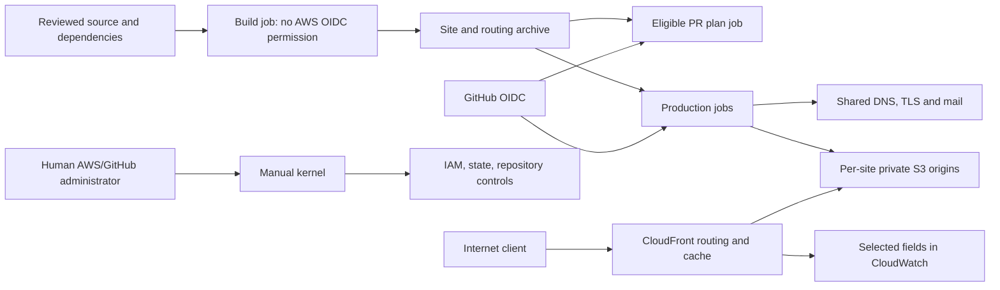

# Threat model: mads-hartmann.com

Draft for maintainer review. Source baseline:
`54e299e89963ccb17f7c5115ee7a2cc273cbd481`, inspected 2026-10-25.
This is an architecture model, not a completed vulnerability audit or a
verification of the deployed AWS/GitHub environment. Paths and line references
below refer to this baseline. Proposed review policy: [SECURITY.md](../SECURITY.md).

## 1. Overview

Four public static sites are built with Node and Jekyll, packaged in GitHub
Actions, and deployed with Terraform to private S3 origins behind CloudFront.
The homepage also serves the apex/www names. Shared infrastructure owns DNS,
TLS validation, mail DNS and a traffic dashboard. The manually applied kernel
owns state storage, IAM/OIDC, GitHub controls and the log-delivery resource policy.

| Component | Responsibility | Source |
| --- | --- | --- |
| Build and artifact | Generate site/routing output and package it for later jobs | `scripts/build.sh:7-40`; `.github/workflows/sites.yml:20-104` |
| Public serving | HTTPS, routing, headers, private S3 origin and object publication | `terraform/modules/static-site/main.tf:18-193`; `routing/markdown.js:1-35` |
| Plans and deploys | PR plan gate, production job graph, fresh plan/apply | `.github/workflows/sites.yml:141-325`; `scripts/deploy-stack.sh:4-34` |
| Kernel | State protection, CI identities, component policies, repository rules | `terraform/kernel/main.tf:6-188` |
| Shared infrastructure | DNS, certificate, mail records and dashboard | `terraform/stacks/shared/main.tf:1-29`; `terraform/stacks/shared/email.tf:4-34`; `terraform/stacks/shared/traffic.tf:52-80` |
| Traffic collection | Selected CloudFront fields delivered to per-site log groups | `terraform/modules/static-site/traffic.tf:3-40`; `terraform/kernel/traffic.tf:3-19` |
| Local preview and examples | Loopback servers; separately invoked historical examples | `sites/blog.mads-hartmann.com/Makefile:16-19`; `sites/blog.mads-hartmann.com/examples/markdown-site/Makefile:7-35` |

### Effective resources and authority

| Workflow | Resource or capability | Configuration and precedence | Safe effective location | Recipients | Enforcing control | Evidence or unknowns |
| --- | --- | --- | --- | --- | --- | --- |
| Build | Generated site and routing files | Build scripts choose output directories; workflow packages them | `.build/{homepage,blog,uses,computer,routing}` in checkout; `sites.tar.gz` | Validation, plan and apply jobs | Same workflow artifact; content checks | `scripts/build.sh:7-40`; `.github/workflows/sites.yml:96-104`; no general archive validator at consumer |
| PR plan | Temporary AWS plan credentials | Repository PR, owner actor, relevant change and enable flag gate the job; role variable selects each role | `mads-sites-<stack>-plan`; current trust subject ends `pull_request` | One job sequentially assumes shared and site plan roles | Workflow gate plus AWS audience/subject checks | `.github/workflows/sites.yml:27-31`, `.github/workflows/sites.yml:141-203`; `terraform/kernel/main.tf:35-76` |
| Production | Temporary AWS apply credentials | Current-main check, Production environment and selected role ARN | `mads-sites-<stack>-apply`; all currently trust `environment:Production` | Shared and site deployment jobs | AWS trust and per-role permission policies | `.github/actions/apply-stack/action.yml:32-64`; `terraform/kernel/main.tf:35-49`; role selection is not stack-specific in trust |
| Automated Terraform | Component state and lock | Script passes stack-local `backend.hcl`; default workspace required | State bucket `terraform-state-cloud-mads-hartmann-com`, `stacks/<stack>.tfstate` and `.tflock`, eu-central-1 | Matching role: state read; apply also state write; both lock writes | Per-role object grants; kernel-state/backend/IAM denies | `terraform/stacks/blog/backend.hcl:1-6`; `scripts/deploy-stack.sh:4-16`; `terraform/kernel/main.tf:51-64`; other stacks follow their checked backend files |
| Site publication | Files and executable edge routing | Stack passes checkout-relative paths to shared module | `.build/<site>`, `.build/routing/<site>.js` to matching S3 bucket and function | Terraform/provider and immutable uploader | Bucket policy; component grants; immutable digest check | `terraform/stacks/homepage/main.tf:2-10`; `terraform/stacks/blog/main.tf:2-10`; `terraform/stacks/uses/main.tf:2-10`; `terraform/stacks/computer/main.tf:2-10`; `terraform/modules/static-site/main.tf:41-45`, `terraform/modules/static-site/main.tf:143-193` |
| Homepage origin | Site object storage | Stack bucket default; production region | `s3://mads-hartmann.com`, eu-central-1 | Homepage role and owning distribution | Module origin policy | `terraform/stacks/homepage/variables.tf:6-9`; `terraform/stacks/homepage/production.auto.tfvars:2` |
| Blog origin | Site object storage | Stack bucket default; production region | `s3://blog.mads-hartmann.com`, us-east-1 | Blog role and owning distribution | Module origin policy | `terraform/stacks/blog/variables.tf:6-9`; `terraform/stacks/blog/production.auto.tfvars:2` |
| Uses origin | Site object storage | Stack bucket default; production region | `s3://uses.mads-hartmann.com`, eu-central-1 | Uses role and owning distribution | Module origin policy | `terraform/stacks/uses/variables.tf:6-9`; `terraform/stacks/uses/production.auto.tfvars:2` |
| Computer origin | Site object storage | Stack bucket default; production region | `s3://computer.mads-hartmann.com`, eu-central-1 | Computer role and owning distribution | Module origin policy | `terraform/stacks/computer/variables.tf:6-9`; `terraform/stacks/computer/production.auto.tfvars:2` |
| Manual kernel | Human administrative credentials and kernel state | Operator AWS environment; GitHub provider token supplied separately | Kernel backend `kernel/terraform.tfstate`; local reviewed `kernel.tfplan` | Human Terraform process and providers | Operator account access and reviewed plan; not a CI job | `terraform/kernel/README.md:1-5`; `terraform/kernel/backend.hcl:1-5`; deployed human permissions not inspected |
| Public requests | Published objects and representations | Viewer-request URI rewrite before cache lookup; distribution selects S3 origin | Public HTTPS domains; GET/HEAD; separate HTML/Markdown object keys | Internet clients via CloudFront | OAC signing, source-distribution bucket policy, TLS and response headers | `routing/markdown.js:1-35`; `terraform/modules/static-site/main.tf:35-39`, `terraform/modules/static-site/main.tf:96-139` |
| Traffic collection | Request metadata | Explicit record-field allowlist and 30-day retention | `mads-sites-<site>-access` in us-east-1 | Log-delivery service; separately authorized human readers | Account/source-scoped delivery policy; viewer permissions external | `terraform/modules/static-site/traffic.tf:3-40`; `terraform/kernel/traffic.tf:3-19` |
| Local previews | Local generated content, including blog drafts | Site Makefile selects directory and loopback bind | Blog: `.build/blog-preview`, port 4000; other sites: corresponding `.build/<site>`, ports 8080/8081/8082 | Local developer/browser | `127.0.0.1` bind; separate blog output | `sites/blog.mads-hartmann.com/Makefile:16-19`; `sites/mads-hartmann.com/Makefile:16-20`; `sites/uses.mads-hartmann.com/Makefile:16-19`; `sites/computer.mads-hartmann.com/Makefile:16-19`; externally exposing preview changes this boundary |

## 2. Threat model, trust boundaries, and assumptions

### Assets and actors

Protect production content integrity, domain and mail routing, certificate
configuration, AWS sessions, human administration credentials, state/plans,
visitor-log privacy, availability and operating costs.

Internet clients control request paths/headers and volume, not repository content
or AWS credentials. Contributors control proposed changes and filenames, not
merge authority merely by opening a PR. Compromised build dependencies can affect
artifact contents without initially receiving an AWS identity. A compromised
deployment job already has its own role's permissions; assess additional role
assumption and resource reach, rather than counting intended own-site writes as
escalation. Human kernel administration is explicitly privileged.

Author-written Markdown and HTML are trusted publication inputs, not visitor
submissions (`sites/uses.mads-hartmann.com/build.mjs:7-30`). Local preview servers
are developer facilities, not production authentication boundaries. No visitor
session, tenant datastore or repository-hosted public upload service is implemented by the reviewed
serving configuration.

The blog post layout includes a Disqus script only when Jekyll's environment is
production. The inspected build command does not explicitly set `JEKYLL_ENV`;
the effective environment and deployed output need checking before claiming
this integration is active or absent. Third-party comments do not create a
repository-hosted submission API, but introduce a browser script/privacy boundary
when enabled (`sites/blog.mads-hartmann.com/src/_layouts/post.html:20`;
`sites/blog.mads-hartmann.com/src/_includes/disqus_comments.html:1-18`;
`scripts/build.sh:24-32`).

### Boundaries and objectives

- **Source to CI:** proposed code can execute in builds; workflow checks and
  identity issuance must preserve the distinction between PR work and production.
- **Build artifact to credentialed consumer:** data/files cross into a checkout
  later read and executed with AWS credentials. Same-run provenance is not a
  substitute for safe member types, paths and content verification.
- **GitHub identity to AWS role:** AWS must enforce the intended workload identity;
  job configuration alone cannot provide isolation.
- **Component to component/kernel:** state and resource authorization must match
  ownership. Bootstrap/tagging authority must not create a path around ownership.
- **CloudFront to S3/browser:** public objects are intended to be public, but origin
  policy, routing, representation selection and security headers protect origin
  exposure and content integrity.
- **Request metadata to logs:** paths/user agents are attacker-controlled, may
  contain sensitive material, and must remain data. Minimize retention and access.
- **Human/local tools to publication:** preserve preview/production separation and
  avoid command execution from lower-trust filenames or data.

### Established controls and qualifications

The kernel configures private encrypted/versioned state, TLS-only state access,
component state grants and explicit IAM/kernel/backend administration denies
(`terraform/kernel/main.tf:6-64`). Production requires main, queued runs and a
freshness check; changed plans are applied in the same job and removed on exit
(`.github/workflows/sites.yml:15-18`; `.github/actions/apply-stack/action.yml:32-39`;
`scripts/deploy-stack.sh:7-18`). Rules require a PR and Checks, but **zero approving
reviews** are configured (`terraform/kernel/main.tf:153-171`).

Origins have public-access blocks, OAC and source-distribution policy conditions.
Security headers include HSTS, frame denial, MIME sniffing protection and referrer
policy; the blog is explicitly excluded from the module's CSP
(`terraform/modules/static-site/main.tf:18-39`, `terraform/modules/static-site/main.tf:61-80`,
`terraform/modules/static-site/main.tf:133-139`).
Locked npm installs disable lifecycle scripts, but generators, Ruby gems and
providers still execute code (`scripts/build.sh:11-40`).

The source declares minimized traffic fields and 30-day storage. This does not
make paths/user agents non-sensitive, prove live delivery settings, or cap request,
ingestion or query charges (`terraform/modules/static-site/traffic.tf:3-40`;
`terraform/stacks/shared/traffic.tf:52-74`).

The supported blog Makefile overrides Jekyll's host to loopback. A direct
`jekyll serve` invocation using the base configuration without that override
instead binds `0.0.0.0:4000`; network exposure depends on the host/firewall and
draft inclusion on invocation flags (`sites/blog.mads-hartmann.com/src/_config.yml:41-46`;
`sites/blog.mads-hartmann.com/Makefile:16-19`).

### Source gaps and documentation discrepancies

These are baseline observations, not accepted risks or evidence that the running
cloud fix tasks have resolved anything.

- Deployment docs claim components cannot assume other component roles
  (`docs/deployment.md:32-38`), but apply trust uses the same Production subject
  across roles (`terraform/kernel/main.tf:35-46`).
- Docs describe owner-authored PR gating (`docs/deployment.md:45-49`).
  The workflow actually checks the invoking actor, same repository and change/
  enable conditions (`.github/workflows/sites.yml:27-31`). AWS trust does not
  independently encode that actor/change gate.
- Archive extraction precedes credentials without a general member validator
  (`.github/actions/apply-stack/action.yml:40-54`); PR planning also extracts the
  artifact (`.github/workflows/sites.yml:157-169`).
- Component policies contain wildcard OAC/response-header writes and initial
  tagging that accepts absent ownership tags (`terraform/kernel/main.tf:86-94`).
  Function mutation relies on a Stack tag; the function resource has no explicit
  tags block (`terraform/modules/static-site/main.tf:41-46`). Provider behavior
  and live tags require verification before claiming that boundary works.
- The published standalone Make example passes filesystem-derived names into
  shell recipes (`sites/blog.mads-hartmann.com/examples/markdown-site/Makefile:7-35`).
  Its execution is a separate developer workflow, not the production build.

### Unresolved deployment and owner decisions

Confirm a private reporting channel and any support/response commitments. No
exclusions or accepted risks are established by this draft. Confirm live kernel
application, environment/ruleset enforcement, effective attached IAM policies,
OIDC subject customization, log readers/retention, budget alerts and any untracked
cloud resources. Verify remediation after merge and, where needed, manual kernel
application. Update this baseline when the five fix tasks land.

## 3. Attack surface, mitigations, and attacker stories

The scenarios below guide review. They are not a new scan or a claim of successful
exploitation. Existing Security Cloud reports provide prior evidence for the
artifact, role-isolation, CloudFront authorization and Make-example concerns;
their detailed reports remain separate.

| Priority | Scenario and capability gain | Prerequisites | Impact | Existing controls | Mitigation | Evidence |
| --- | --- | --- | --- | --- | --- | --- |
| First | Build-controlled artifact influences privileged reads/execution | Build compromise reaches a credentialed consumer | Secret disclosure or unauthorized deployment | Same-run artifact, pinned actions, content checks | Isolated extraction, safe types/paths, verified content before credentials/use | `.github/workflows/sites.yml:96-104`; `.github/actions/apply-stack/action.yml:40-64` |
| First | One production workload obtains another apply identity | Execution in eligible Production job | Cross-site/shared DNS or mail authority | Audience/repository checks and per-role permissions | Distinct enforceable workload subjects; negative cross-role tests | `terraform/kernel/main.tf:35-49`; `.github/workflows/sites.yml:204-325` |
| Next | Component credential mutates shared CloudFront configuration or adopts unrelated resources | Existing component credential; relevant external resources for adoption | Cross-component integrity/availability | Named/tagged subsets and scoped bucket/state grants | Restrict steady-state ownership; separately control bootstrap and global configuration | `terraform/kernel/main.tf:78-100` |
| Next | PR-controlled code acquires more authority than intended | A reachable credentialed plan path or gate bypass | State/content reads or broader downstream impact | Workflow eligibility checks; plan policies deny infrastructure writes | Verify all trust-policy and trigger paths; test ineligible PR cases | `.github/workflows/sites.yml:27-31`, `.github/workflows/sites.yml:141-203`; `terraform/kernel/main.tf:51-76` |
| Next | Routing/origin/cache error exposes unintended content or changes another user's representation | Specific request-controlled route or configuration error | Content exposure/integrity | GET/HEAD, OAC, URI rewrite before cache, headers | Preserve canonical routing/cache separation and private origins; test adverse requests | `routing/markdown.js:1-35`; `terraform/modules/static-site/main.tf:96-150` |
| Next | DNS/TLS/mail configuration gains exceed intended stack authority | Relevant role compromise or unsafe authorized rollout | Domain authenticity, mail integrity/availability | Scoped names/types, certificate domain constraints | Test negative record/type/domain permissions and verify actual mail signing separately | `terraform/kernel/main.tf:95-130`; `terraform/stacks/shared/email.tf:4-34` |
| Review | Logs expose private request details, or traffic increases cost | Logged sensitive path/agent, reader access, or sustained requests | Privacy loss or spending/availability impact | Selected fields, 30 days, scoped service delivery | Verify live fields/readers; establish cost monitoring; avoid treating values as instructions | `terraform/modules/static-site/traffic.tf:3-40`; `terraform/kernel/traffic.tf:3-19` |
| Review | Crafted example filenames cause unintended local commands | Attacker-influenced tree and developer runs example | Developer-account execution | Separate historical example, no normal build invocation | Safe filename/argument boundary; update copied article examples; regression cases | `sites/blog.mads-hartmann.com/examples/markdown-site/Makefile:7-35`; `scripts/build.sh:9-32` |
| Review | Third-party script changes affect blog visitors | Production Jekyll environment enables Disqus; third-party script compromise or changed behavior | Browser-origin integrity and privacy | Conditional inclusion; blog has no module CSP | Establish intended integration/privacy requirements and inspect deployed output; constrain third-party execution where compatible | `sites/blog.mads-hartmann.com/src/_includes/disqus_comments.html:1-18`; `terraform/modules/static-site/main.tf:75-80` |
| Review | Private drafts or retired sensitive bytes remain accessible | Preview exposure, accidental publication, or retained old objects | Confidentiality loss | Loopback preview; separate blog directory; publication checks | Verify artifact contents; explicit origin/CDN removal when required; do not promise browser recall | `sites/blog.mads-hartmann.com/Makefile:16-19`; `terraform/modules/static-site/main.tf:153-193`; `scripts/upload-immutable-assets.py:11-29` |

## 4. Severity calibration

These are proposed examples, not automatic severity assignments.

- **Critical:** a demonstrated low-precondition route from an internet client or
  untrusted PR to broad administrative takeover or similarly systemic impact.
  No such route is established by this model; a wildcard alone is insufficient.
- **High:** credible production credential disclosure, unauthorized publication,
  or cross-stack DNS/mail authority from a materially narrower starting position.
  State the build/deployment compromise prerequisite and real permission scope.
- **Medium:** meaningful but bounded cross-component changes, sensitive log
  exposure, or service disruption with constrained reachability. Reduce or raise
  the assessment when evidence changes the reachable privilege or impact.
- **Low:** a real but narrowly reachable developer/example boundary failure or a
  configuration-dependent issue with limited demonstrated exposure. A historical
  example is not automatically exempt or automatically production-critical.

Trusted author HTML is not evidence of visitor-controlled XSS. Reading intended
public pages is not disclosure. Merely assuming total administrator compromise,
or naming a dependency CVE without a reachable use, does not establish added
impact. Conversely, tests and protected-main rules do not automatically dismiss
a genuine lower-to-higher privilege transition.

Confidence describes evidence quality separately from severity. Record missing
live-state evidence explicitly. Revisit this model when architecture, workflow
trust, dependencies, privacy requirements or deployed controls change.

Repository: sha256:ae7aa5c65a38e472f15eb4d0450891727903aa63ed95768cb35b19dcc775f93d
Version: 54e299e89963ccb17f7c5115ee7a2cc273cbd481
